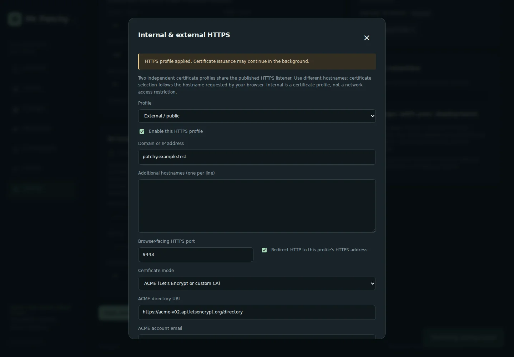

# Docker bindings and independent HTTPS profiles

## Bind addresses and ports

Only Caddy publishes ports. The application port 8000 and Caddy administration port 2019 remain inside Docker networks; do not publish them as a shortcut around TLS.

| Variable | Default | Purpose |
|---|---|---|
| `BIND_IP` | `0.0.0.0` | Host address for HTTP and HTTPS; use a specific assigned address or `127.0.0.1` for local-only access |
| `HTTP_BIND_IP` | `BIND_IP` | Optional HTTP-only address override |
| `HTTPS_BIND_IP` | `BIND_IP` | Optional HTTPS TCP / HTTP/3 UDP address override |
| `HTTP_PORT` | `80` | Host TCP port mapped to Caddy port 80 |
| `HTTPS_PORT` | `443` | Host TCP and UDP ports mapped to Caddy port 443; default browser redirect port |
| `DOMAIN` | `localhost` | First-start Internal profile hostname or IP; saved settings take precedence afterward |
| `PUBLIC_URL` | `https://localhost` | Canonical enrollment-link and OIDC callback origin, including any browser-facing nonstandard port |

Compose's long port syntax also accepts IPv6 bind addresses without bracket/colon ambiguity. Bind only addresses assigned to the Docker host. `BIND_IP=::` follows the host's IPv6/dual-stack behavior; use an explicit assigned address if you need a precise interface boundary. Host networking is not required.

Example `.env`:

```dotenv
ADMIN_PASSWORD=replace-with-a-long-unique-password
BIND_IP=192.168.1.20
HTTP_PORT=8080
HTTPS_PORT=8443
DOMAIN=patchy.home.example.com
PUBLIC_URL=https://patchy.home.example.com:8443
```

Apply with `docker compose up -d --build`. Check mappings with `docker compose ps`. For localhost behind a separate proxy, use `BIND_IP=127.0.0.1` and have that proxy reach the published HTTPS port with certificate verification. No additional proxy is required for the built-in dual-profile workflow.

Keep `CONTROL_SUBNET`, `CADDY_CONTROL_IP` and `APP_CONTROL_IP` separate from the published address. They define the private, trusted proxy hop. Change all three together only when avoiding a Docker subnet conflict.

## Internal and External / public profiles

In **Settings → Configure HTTPS**, select the profile, enable it, enter its hostname and optional aliases, and choose its certificate mode. Save each profile separately; updates preserve the other profile. At least one must remain enabled, and enabled profiles cannot share a hostname or alias.

| Example profile | Hostname | Certificate source |
|---|---|---|
| Internal | `patchy.home.example.com` | Your private ACME directory and its uploaded root CA bundle |
| External / public | `patchy.example.com` | Let's Encrypt, `https://acme-v02.api.letsencrypt.org/directory` |

Both profiles share the same published HTTPS address and port. Caddy chooses the certificate using the requested hostname (SNI). This does not support two different certificates for the *same* hostname based on client location. Separate DNS names are required. Neither the Internal label nor use of a private CA restricts who can reach a route; enforce LAN-only access with routing/firewall controls where needed. Both names provide the same authenticated Mr Patchy application, with separate browser cookies for each hostname.

Certificate modes:

- **Built-in local CA:** suitable for bootstrap/private deployments. Export Caddy's root with `docker compose cp caddy:/data/caddy/pki/authorities/local/root.crt ./mrpatchy-local-ca.crt` and trust it on administrator devices.
- **Uploaded certificate:** upload a current PEM chain and matching unencrypted private key. The SAN must cover the domain and every alias. Leave uploads empty to keep saved material. Caddy does not renew uploaded certificates. An uploaded certificate may not overlap an automatically managed profile's hostnames, because that can interfere with automatic certificate selection; use a certificate scoped to its profile. Two uploaded profiles have explicit per-profile certificate selection.
- **ACME:** configure an independent directory, account email, CA trust bundle, optional EAB key ID/HMAC key, and challenge preference for each profile. A blank directory uses Let's Encrypt. Custom CAs have no fallback to a different public issuer. Trust bundles are for validating the ACME server's TLS connection; clients separately need to trust the CA that signs the resulting site certificate.

Blank CA/EAB uploads retain saved material. Explicit clear controls remove it. Changing the ACME server/account while retaining sensitive settings is rejected unless new material is supplied or the old settings are explicitly cleared. Neither private keys nor EAB HMAC keys are returned by the settings API. Certificate material and profile state are stored with restrictive permissions in the existing `tls-config` volume; include that volume in backups.

## Ports, redirects and ACME reachability

By default, HTTP redirects point to the profile hostname at `HTTPS_PORT`, preserving path and query. HTTP/3's Alt-Svc advertisement uses the same port; forward UDP as well as TCP if you want HTTP/3 through a router. Leave the profile's **Browser-facing HTTPS port** blank to follow Docker's published port. If a router maps external 443 to host 8443, set that profile's override to `443`; if LAN clients use host 8443 directly, leave their profile's override blank. Changing an override affects URLs and advertisements, not Docker socket bindings. Disabling HTTP redirects returns an HTTP 404; it does not expose password login over plaintext HTTP.

Public HTTP-01 validation arrives on external TCP 80, and TLS-ALPN-01 on external TCP 443. Forward the selected challenge port to Caddy's published host port. Setting `HTTPS_PORT=8443` alone does not make a public CA validate on external 8443. Select HTTP-only or TLS-ALPN-only if only one path is reachable. The stock image does not include DNS-provider plugins/DNS-01 or wildcard issuance. For a hostname that cannot pass either challenge, upload a certificate issued through your existing certificate workflow.

Certificate acquisition and renewal run asynchronously in Caddy. A successful apply means the configuration was accepted; it does not claim the CA has already issued a certificate. Inspect `docker compose logs caddy` for issuance status. Avoid repeatedly requesting production certificates while debugging reachability.

`PUBLIC_URL` remains deployment-wide. Set it to the canonical origin reachable by targets/users consuming generated enrollment links and register its `/auth/sso/callback` URL at the identity provider. Enabling the second profile does not rewrite that origin or share login cookies between hostnames.

## Migration, persistence and recovery

The startup script recognizes earlier Mr Patchy-generated single-site Caddyfiles and migrates their current domain, mode, uploaded certificate/key and custom ACME trust into the Internal profile. The External profile starts disabled. It does not replace existing certificates with the bootstrap CA. Unsupported manually written Caddyfiles fail migration instead of being silently overwritten; restore a generated configuration or migrate it through a reviewed backup first.

Each save stages a complete two-profile configuration plus its protected material. One atomic Caddyfile replacement commits the matching profile state. If Caddy rejects a change, or persistence fails after applying it, Mr Patchy attempts to restore the previous live configuration. An uncertain rollback preserves its staged files with a `recovery-required` marker; inspect Caddy before removing them. Earlier generations remain available for recovery and are not automatically deleted.

Existing saved profiles survive app/Caddy restarts. Changing `DOMAIN` later does not override them. The legacy `PUT /api/tls` endpoint edits the Internal profile; `PUT /api/tls/internal` and `/api/tls/external` edit explicit profiles, and `GET /api/tls` returns redacted metadata. All require administrator authorization.

Validation includes native Caddy adaptation of independent ACME policies and EAB/trust configuration, migration and rollback regressions, browser profile switching/redaction, and CI using real Docker IP/port publication, verified TLS for both names, redirects on 18443, and Caddy restart persistence. Live public/private CA issuance still depends on your DNS, trust, CA policy and network routing.


