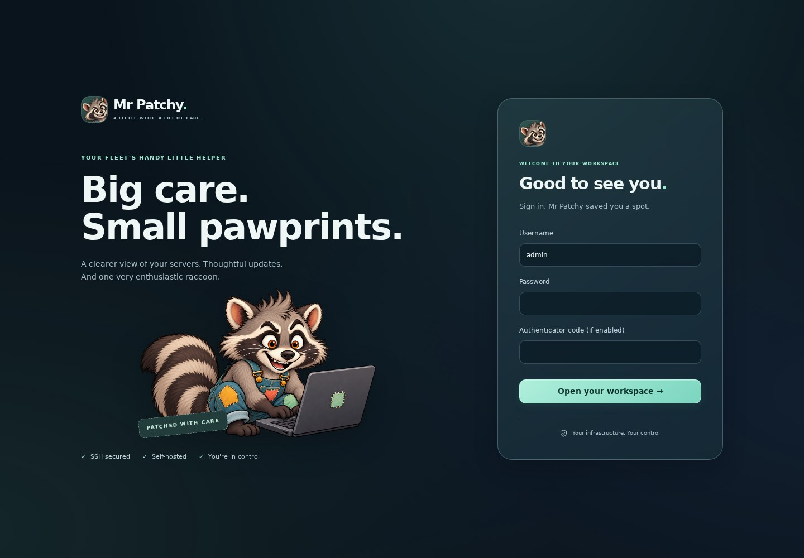
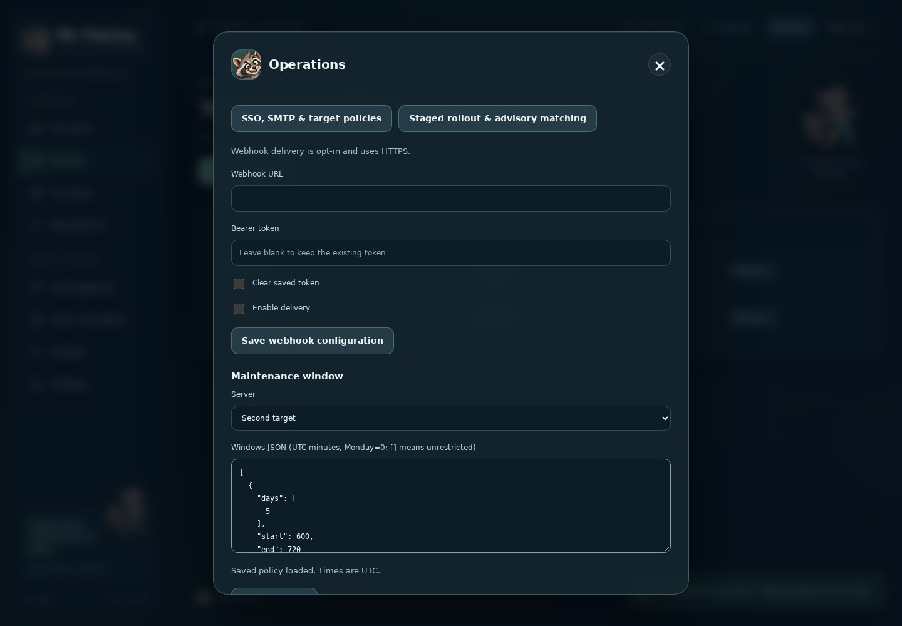

# Code and interactive browser review — October 25, 2026

Reviewed from main `c7ccdec656b1ea56fc71c6cade6f078502489885`, after PR #5 merged. Fixes are proposed on `fix/full-review-usability`. This review covers the application and target trust boundaries, operational recovery, frontend workflows and their tests; it is not a certification that the system contains no remaining vulnerabilities.

## Findings and fixes

Severity reflects practical impact within Mr Patchy's existing trust model: administrators can intentionally deploy root code, while viewers/operators must remain restricted.

| Severity | Finding | Resolution and evidence |
|---|---|---|
| Medium — security | Password/MFA verification inside authenticated account actions bypassed the login attempt limit, allowing repeated guesses | A shared account bucket limits password verification, MFA setup/confirmation and session revocation to ten attempts per five minutes. Regression tests exercise every endpoint, cross-endpoint attempts and expiration. Incorrect step-up credentials return 403 without falsely expiring the current session. |
| Medium — correctness | MFA replacement inherited the old secret's replay counter and could reject a valid new-secret code in the same time step | Pending secrets use their own counter domain. Activation still records the consumed counter and prevents replay with the new secret. |
| Medium — configuration | Maintenance controls displayed a hardcoded example instead of saved policy, risking schedule replacement | Load the saved server policy before enabling editing/saving; ignore responses from previously selected hosts. Browser tests cover persisted values and out-of-order responses. |
| Medium — configuration/security | SMTP/webhook forms did not load settings, and blank password/token submissions silently erased credentials | Added administrator-only redacted metadata retrieval, form hydration, blank-secret retention and explicit clearing. Prevent implicit credential reuse across changed destinations/accounts and across channels. API tests verify redaction, permissions, clearing and channel transitions; browser tests verify a metadata-only save retains the SMTP credential. |
| Medium — correctness | An old page response could replace the newly selected page; pending dialog responses could reopen dismissed dialogs | Added view/session revisions and dialog guards, cleared sensitive DOM on logout, and invalidated stale responses. Tests delay dashboard/settings/history/MFA requests across navigation, close and sign-out. Existing release-plan race tests remain in place. |
| Medium — availability | An AI follow-up for an unverified/exited executable attempted SSH evidence with an invalid identity, repeatedly failing instead of finishing | Pass explicit uncertainty to the follow-up assessment without making an unverifiable SSH request. A regression verifies two bounded model calls, no remote request and an unapproved `unknown` result. |
| Medium — usability | Mobile CSS hid Account and Sign out with the sidebar footer | Move both controls into the responsive header. Interactive browser checks verify accessibility at 320px and 390px. |
| Low — usability | Viewer/operator screens presented administrator-only navigation and actions that failed when used | Role-aware navigation, inspection controls and disabled priority editing; viewers cannot select patch rows. Browser coverage tests all three roles. Server-side authorization remains independent of presentation. |
| Low — operations | Queued cancellation existed in the API but was unavailable in Activity; rapid patch clicks could submit twice | Added explicit queued-cancellation confirmation and disabled patch confirmation while submitting. Browser tests verify persisted cancellation and one request from repeated clicks. |
| Low — presentation | Notifications outside a modal's top layer were difficult to see; login field placement, narrow headings and focus affordances needed work | Inline live dialog feedback, correctly ordered login labels, accessible dialog title, visible keyboard focus and responsive wrapping. Browser tests cover failed reauthentication, Escape dismissal and no page overflow; screenshots were visually inspected and refreshed. |

## Scope and validation

Review included authentication/session/CSRF/RBAC, OIDC identity binding, secret storage, notification delivery, SSH bootstrap and key rotation, central APT trust and policy handling, target command validation and provenance, worker coordination and recovery, release planning/execution, backup scripts, TLS/container configuration, and the browser application. Previously remediated repository-signature, rollback-state, process-provenance and worker issues retain their regression coverage; see [REVIEW_FIXES.md](REVIEW_FIXES.md).

Local validation:

- Full Python suite: **250 passed, 2 skipped**. The optional MySQL concurrency and real-restic tests require tools/services absent locally and run in CI instead.
- Chromium/Playwright interactive workflows and automated regression suite: desktop 1440×1000; mobile 390×844 and 320×844. Enrollment/download, repository access, patch and release approval, account/roles, maintenance/SMTP metadata, queued cancellation, stale-response handling and modal errors exercised. No browser JavaScript exceptions or page-level horizontal overflow in the tested narrow layouts. Wide tables scroll within their containers.
- Python compilation, JavaScript syntax, shell syntax and Git whitespace checks.
- Bandit source scan reviewed: its medium findings concern the fixed SSH bridge command and intentionally executable, root-owned service-start guard; these do not establish command injection or unsafe writable permissions. Static scanning complements the code review and tests; it does not prove safety.
- Screenshots regenerated from the actual application using illustrative fixture data and reserved documentation addresses. No customer infrastructure or credentials appear in them.

The PR's six CI jobs cover SQLite/Docker/Caddy, MySQL, Ubuntu SSH, Debian SSH, Chromium, and restic recovery. Consult the PR checks for their results on the exact proposed commit.

## Deployment and remaining acceptance work

This follow-up changes central application/UI code only. Rebuild/restart the central application and workers; no database migration or target-helper redeployment is needed for this PR. Keep any earlier target-helper upgrade requirements from PR #5. Existing notification configuration is retained; clients that intentionally erase a credential must now send `clear_password` or `clear_token`. The metadata endpoint never returns either secret.

Rate limits remain process-local, as in the single-web-process deployment. Distributed task workers are supported; multiple independent web replicas need shared throttling and transactional MFA consumption before deployment. Do not infer multi-web-replica authentication guarantees from distributed-worker tests.

Real distribution upgrades, Raspberry Pi/systemd hardware, live IdP/SMTP/custom ACME services, kernel eBPF attachment, bootable snapshot rollback, external backup-provider connectivity and a complete MySQL dump/import disaster-recovery drill remain deployment acceptance tasks. Browser fixtures and simulated SSH/model responses do not validate those environments. This review made no paid model calls and performed no changes on live managed servers.

## Suggested next improvements

1. Add deployment acceptance jobs on disposable Ubuntu/Pi VMs with real reboot/rollback and isolated IdP/SMTP/ACME services, including a MySQL recovery drill.
2. Replace maintenance-window JSON and rollout server-ID entry with validated form controls and a UTC schedule preview.
3. Split the frontend into tested modules; add accessibility auditing and automated visual comparison to the existing browser workflows.
4. Add shared authentication throttling/MFA transactions before supporting multiple web replicas; benchmark large-fleet inventory and investigation workloads before setting capacity guarantees.

