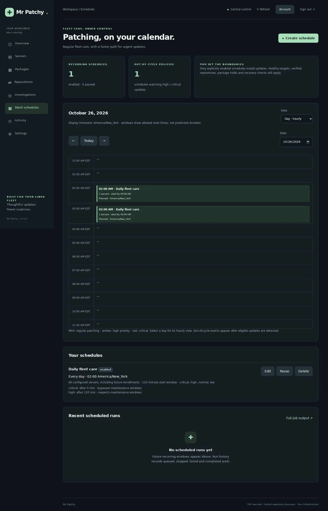
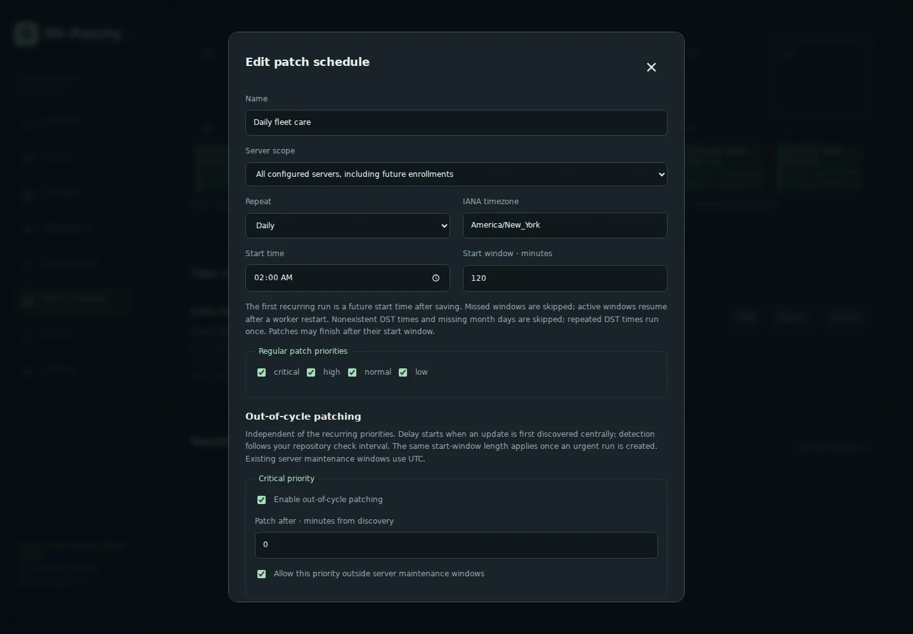

# Patch schedules

## Configure a schedule

Administrators use the dedicated **Patch schedules** menu. New schedules are paused by default. Choose a name, all configured servers or selected servers, daily/weekly/monthly recurrence, IANA timezone, local start time, start-window length (15–1,440 minutes), and regular patch priorities. All-server scope explicitly includes future enrollments. Selected-server scope stays fixed.

Approve future unattended installations before enabling, then review the scope, timing, priority overrides and recovery permissions. Saving a change increments the policy revision, cancels queued work for the previous revision, and starts future recurring occurrences. Running package operations may finish. Pause stops both recurring and urgency rules; delete retains run history. Stale editors cannot overwrite newer policy revisions. At most 100 schedules may be configured.

The common approved reboot/rollback choices must match each target's existing recovery policy. The editor shows mismatches and execution blocks them. Use separate schedules for servers with different policies, or deliberately change target policies under **Account → Operations → SSO, SMTP & target policies**. Selecting rollback does not create snapshot support; the existing tested recovery adapter is still required. Newly enrolled hosts have to satisfy the same checks.

## Calendar and time semantics

The month calendar shows future recurring start windows and recorded regular/urgent runs. Select a day or **Day · hourly** to inspect hourly windows; each hour includes overlapping events. The browser timezone is displayed above the calendar, while schedule labels preserve the configured timezone. Windows indicate when installation may start, not predicted patch duration. Jobs can finish afterward. Actual queue availability, target health and server maintenance windows may delay or prevent a run.

Recurrences follow the schedule's IANA wall clock. Nonexistent spring-forward times are skipped; repeated fall-back times run once, at the first occurrence. A monthly day absent from a month (for example, February 31) is skipped. Hourly display preserves repeated and missing local hours. Docker includes tzdata for timezone rules.

The first recurring start must be after the last policy save. A worker restart can resume an occurrence only while its start window is still open; there is no backlog of missed occurrences to execute later. Expired queued installations are cancelled and recorded as skipped. Existing per-server maintenance windows remain defined in UTC and further restrict regular schedules.

## High and critical out-of-cycle rules

Each priority has independent enablement, a delay in minutes from the update's first central discovery (0–43,200), and an explicit permission to bypass server maintenance windows. Neither is enabled by default. Out-of-cycle rules are independent of regular priorities: a normal-only regular schedule can still handle critical fixes immediately. They apply only to matching eligible packages, although APT may need dependency changes under the existing no-removal policy.

The scheduler evaluates every 30 seconds, but it cannot discover updates faster than repository checks. The default repository check interval is 60 minutes. A zero-minute urgent delay means the next scheduler opportunity after discovery and safety checks, not immediate awareness of an upstream publication. Superseding versions retain the first-discovery deadline while an update remains outstanding.

An urgency run gets the same start-window length as the regular schedule, measured from when that urgent run is created. Without the explicit bypass, it waits for the server's maintenance window and is skipped if none opens in time. Urgent events appear on the calendar only once updates have triggered a run; they are not predicted future vulnerabilities.

Each unchanged eligible urgent package/version/discovery-time batch is attempted once per approved schedule revision. Failed, cancelled, blocked or skipped urgent batches are not repeatedly requeued. Investigate Activity, then patch manually or review and save the schedule to authorize a new attempt. A changed eligible batch can create a new run. Regular patching has a new opportunity at its next recurrence.

## Execution and safety

The scheduling leader creates durable runs under a cross-process database/filesystem coordination lock. Stable run identities and atomic run/job writes prevent duplicate occurrences across worker restarts or competing workers. Existing worker host locks serialize installations; overlapping schedules wait for already queued target work. This is regular package maintenance, not a staged canary rollout and not a distribution release upgrade.

A run requires an enrolled, online target with telemetry within 120 seconds, no integrity findings, a pinned SSH fingerprint and inventory. Running/recovery-required target operations and existing queued mutations defer it. It requests a fresh central signed repository resolution before selecting candidate versions; a failed refresh never authorizes installation. Packages that are held, not fully installed or without an update are excluded. More than 500 selected updates block the run for reviewed manual batches.

Immediately before execution, authorization, the start deadline, health and applicable windows are checked again. The executor collects inventory, revalidates exact candidate versions and scheduled priority eligibility, enforces unchanged recovery behavior and checks post-patch service health. Repository and target signature/identity controls are unchanged. Package maintainer scripts may restart services even when automatic reboot is off.

Interrupted package transactions are never automatically replayed. Existing recovery quarantine and Activity reconciliation apply. Recent scheduled failures, blocks and expired windows create a host alert, delivered only through already enabled notification settings. Run history includes waiting reasons and results; full job output and manual cancellation/reconciliation are in **Activity**. The main view shows the latest 100 runs; calendar queries are limited to 62 days and 10,000 recorded runs per response. Runs are retained in the database for audit/deduplication.

## API and validation

Administrator authorization is required for all `/api/schedules` endpoints; writes require CSRF. `GET /api/schedules` returns policies, current host recovery policies and recent runs. `POST /api/schedules` creates, `PUT /api/schedules/{id}` updates with the current revision, and `DELETE /api/schedules/{id}` requires that revision. Enabling requires `approved: true`. `GET /api/schedules/calendar?start=EPOCH&end=EPOCH` returns calendar events without issuing jobs. These settings and run tables are created during normal database initialization and included in database backups.

Tests cover timezones and DST, monthly/weekly recurrence, all/selected scope, deduplication across workers, expired windows, disabled/revised policies, held/broken packages, offline/stale/integrity/quarantined targets, recovery-policy mismatches, urgency delays and overrides, refresh failures, exact-version execution and post-patch health. Browser tests exercise creation, approval, persistence, pause/delete and desktop/mobile month/hour views. Live production patch outcomes still depend on the target packages, repository reachability and recovery adapters.

